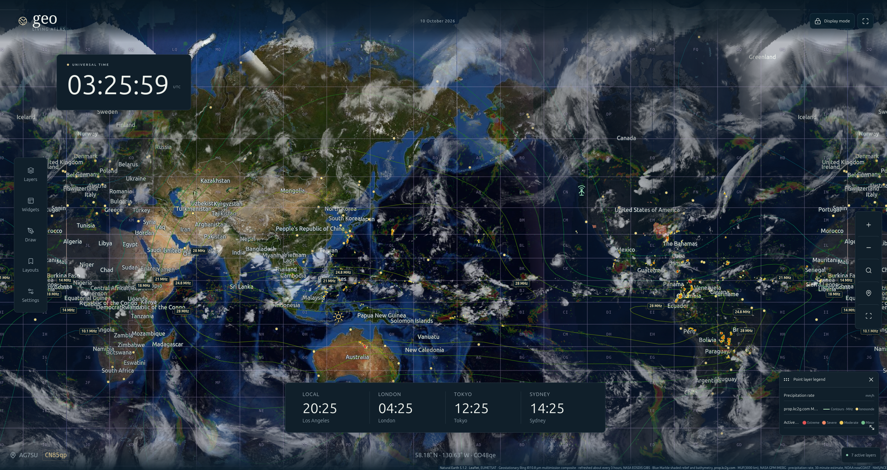

# Geo

Geo is a living world atlas for your desktop or a self-hosted browser display. It combines an interactive map, UTC and world clocks, weather and space-weather overlays, satellite tracking, and amateur-radio activity. Customize the display with layers, widgets, annotations, and saved layouts.



## Install

### Desktop app

Download the package for your operating system from [GitHub Releases](https://github.com/tcarwash/geo/releases):

- **Windows:** run the setup executable.
- **macOS:** open the DMG and drag Geo into Applications.
- **Linux:** install the DEB package, or extract the ZIP and run `geo`.

The desktop app runs its own local service; Docker and a separate server are not required. Settings and saved data stay in the application's per-user data directory. See the [desktop guide](desktop/README.md) to build from source.

### Self-host with Docker Compose

Install Git and Docker with the Compose plugin, then run:

```sh
git clone https://github.com/tcarwash/geo.git
cd geo
cp .env.example .env
docker compose up -d --build
```

Open **http://127.0.0.1:8082** on the host. Edit `.env` to change ports or deployment settings, then rerun `docker compose up -d --build` to apply them.

For access from other machines on your trusted LAN, set `GEO_WEB_BIND` to the host's LAN address. Keep the API bound to loopback; the web service forwards API requests for browsers. For an internet-facing display, use `GEO_DEPLOYMENT_MODE=public` behind a TLS reverse proxy. See the [deployment guide](backend/README.md#publicshared-large-display-deployment) for proxy and access configuration.

Docker stores saved layouts, annotations, imported contacts, and cached data in the `geo-data` volume. Preserve this volume when updating. See the [backend guide](backend/README.md#run-with-docker-compose) for backup and restore commands.

To update:

```sh
git pull
docker compose up -d --build
```

## Set up your display

1. Open **Settings** to set your station name, callsign, coordinates, and world-clock timezones.
2. Open **Layers** to choose a base map and enable overlays. Layer details show the source, timestamps, coverage, and any limitations; use opacity controls to combine overlays.
3. Add clocks, notes, station information, a space-weather panel, a layer legend, or an embedded dashboard through **Widgets**. Use **Draw** for map annotations.
4. Save a named view under **Layouts**. Export/import a layout to move it between installations or browser profiles.

The current view saves automatically in your browser. In desktop and private server mode, named layouts and saved annotations persist in the local service. In public mode, each browser keeps its own setup; shared writes, imported contacts, and personalized/local radio feeds are disabled.

### WSJT-X

In desktop or private server mode, enable UDP reporting in WSJT-X and send it to `127.0.0.1:2237`, then enable the **WSJT-X heard stations** layer in Geo. Geo maps recent decodes with reported Maidenhead grids. For a separate WSJT-X machine or a different UDP port, see the [local adapter setup](backend/README.md#run-with-docker-compose).

## Using Geo

- **Explore:** drag to pan, zoom with the map controls, and select map features for details. Use Go to for countries, coordinates, or Maidenhead locators; Return to station recenters the map.
- **Display mode:** hides editing controls for a dedicated map display. Fullscreen hides controls after six seconds; pointer or keyboard input reveals them.
- **Chron mode:** shows a solar-time ruler, centered noon meridian, and day/night grayline. Drag vertically to pan; horizontal movement follows solar time. Select a world clock to add its civil-time ruler. The UTC card opens Layers/Settings, and the fullscreen and Exit Chron buttons sit at the lower right.
- **Custom sources:** Layers → Add a custom source accepts XYZ tiles, WMS overlays, and GeoJSON files. Private mode also supports API-pushed GeoJSON.
- **Keyboard:** `G` opens Go to, `L` opens Layers, and `Esc` closes panels or exits Chron mode. Selected widgets move with arrow keys and resize with Shift+arrow keys.

The bundled political atlas works without a network connection in the desktop app. Live feeds and remote imagery require internet access; browser reloads while offline are not guaranteed. Layers can be observations, forecasts, static references, or historical datasets. Check their timestamps and source notes; Geo is an informational display, not a navigation or emergency-warning system. See the [data-source guide](data.md) for provider coverage and terms.
